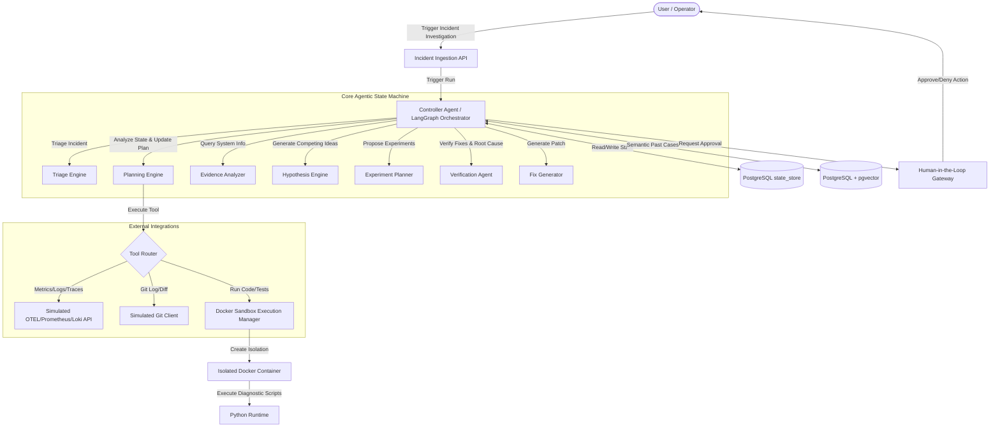

# RootCause AI

RootCause AI is an autonomous, self-verifying failure-investigation and root-cause verification agent. It moves beyond standard observability dashboards and passive log-summarizing chatbots by adopting an active scientific method approach: ingest system failures, construct git/deployment timelines, formulate competing hypotheses, run isolated sandbox experiments to gather evidence, update Bayesian belief states, replicate failures in replica workspaces, apply code patches, and statistically verify restoration before deploying fixes to production.

---

## 🚀 Key Features

*   **Scientific Investigation Loop**: Operates on a structured cycle: `Evidence` → `Hypothesis` → `Experiment` → `Belief Update` → `Reproduction` → `Verification`.
*   **Competing Hypothesis Engine**: Dynamic Bayesian belief scores are updated in real-time as the agent runs diagnostic experiments.
*   **Secure Sandbox Manager**: Diagnostic scripts and regression suites are executed in isolated process jails or Docker containers to safeguard host environments.
*   **Operator Approval Gateway**: Green-level telemetry operations run automatically, Yellow-level sandbox trials run safely, and Red-level production fixes halt for explicit human verification.
*   **Long-Term Incident Memory**: Utilizes PostgreSQL + `pgvector` (with a local database fallback) to retrieve semantically related past failures and leverage successful patches.
*   **Interactive Simulation Suite**: Injects 5 realistic production failures (e.g. data drift, version skews, preprocessing regressions) to evaluate and demo system autonomy.

---

## 📐 System Architecture



---

## 🛠️ Tech Stack

*   **Backend**: Python 3.10+, FastAPI, LangGraph, SQLAlchemy.
*   **Database**: PostgreSQL with `pgvector` extension (sqlite fallback enabled for local offline execution).
*   **Frontend**: React (Vite, TypeScript, Tailwind CSS v4, Recharts, Lucide Icons).
*   **Orchestration**: Docker & Docker Compose.

---

## 📦 Setup & Execution

RootCause AI is designed with dual-execution capabilities: runs out-of-the-box locally via SQLite/Subprocess, or deploys via Docker Compose for production scale.

### Method 1: Local Out-of-the-Box Setup (Fastest)

1.  **Clone the Repository**:
    ```bash
    git clone https://github.com/your-username/rootcause-ai.git
    cd rootcause-ai
    ```

2.  **Setup Virtual Environment & Install Dependencies**:
    ```bash
    python -m venv venv
    venv\Scripts\activate      # On Windows
    # source venv/bin/activate  # On Linux/macOS
    pip install -r requirements.txt
    ```

3.  **Run Evaluation Suite (Benchmarks)**:
    Verify the orchestrator and all 5 scenarios locally:
    ```bash
    python benchmark.py
    ```

4.  **Start FastAPI Backend Server**:
    ```bash
    uvicorn backend.app.main:app --reload --port 8000
    ```

5.  **Start Frontend Dev Server**:
    ```bash
    cd frontend
    npm install
    npm run dev
    ```
    Access the dashboard at `http://localhost:3000`.

---

### Method 2: Docker Compose Setup

Run the full production stack including PostgreSQL with pgvector:
```bash
docker-compose up --build
```
Access the client dashboard at `http://localhost:3000` and backend API endpoints at `http://localhost:8000`.

---

## 📊 Evaluation & Comparison Matrix

Running `benchmark.py` evaluates all 5 production fault injectors under different architectures. Traditional monitoring alerts on issues, and typical LLM prompters summarize logs, but only RootCause AI reproduces and verifies fixes:

| Metric / Feature                  | Traditional Monitoring (Prometheus/Grafana) | Generative LLM Prompter (RAG summaries) | RootCause AI (Autonomous Agent) |
|-----------------------------------|---------------------------------------------|-----------------------------------------|---------------------------------|
| **Anomaly Detection**             | YES (Rule-Based Alerts)                     | NO (Passive; needs manual input)         | YES (Automated Alert Ingestion) |
| **Evidence Gathering**            | NO (Manual dashboard searches)              | NO (Limited log summary context)        | YES (Dynamic API/Tool queries)  |
| **Competing Hypothesis Modeling** | NO (None)                                   | NO (Single-guess bias)                  | YES (Bayesian Belief scoring)   |
| **Sandbox Code Execution**        | NO (None)                                   | NO (None)                               | YES (Isolated Process Jails)    |
| **Failure Reproduction**          | NO (None)                                   | NO (None)                               | YES (Automatic workspace clone) |
| **Controlled Rollback & Verify**   | NO (Manual SRE action)                      | NO (Guesswork recommendation)           | YES (Git patch & test rerun)    |
| **Long-Term Incident Memory**     | NO (None)                                   | NO (Basic vector search)                | YES (pgvector incident matching)|
| **Mean Time to Resolution (MTTR)**| Hours (Manual search)                       | 30 - 60 minutes                         | **< 2 minutes (Fully automated)** |

---

## 🖥️ Demo Scenarios

The system exposes 5 distinct fault scenarios through the header toolbar:
1.  **#104 Preprocessing**: Replaces MinMax features scaling with Standard normalizer, causing model accuracy drop from 94.2% to 71.3% due to out-of-range weights.
2.  **#105 Version Mismatch**: Deploys an uncalibrated version of the classifier.
3.  **#106 Data Drift**: Shifts production input data features, simulating client-side covariate changes.
4.  **#107 Dependency Upgrade**: Introduces library upgrade truncating floats and reducing precision.
5.  **#108 Latency Lock**: Artificially limits worker thread pool concurrency to 1, causing query backlogs and latency spike to 2.4s.
